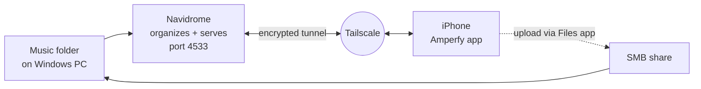

# Self-Hosted Music Streaming

Replace a paid streaming subscription with your own ad-free music server. Your library lives on a Windows PC, and you stream it to your phone from anywhere. No public ports, no cloud storage, no monthly fee.

Built with **Navidrome** (music server), **Tailscale** (private network), and **Amperfy** (iOS client), plus an SMB file share for uploading music remotely.

---

## Features

- Spotify-style library on your phone: albums, artists, artwork, playlists, search, shuffle
- Streams from anywhere over an encrypted private network
- Nothing exposed to the public internet (no port forwarding)
- Upload new music from your phone through the iOS Files app
- Optional iOS Shortcut that runs commands on the PC over SSH
- Free and open source end to end

## How it works



| Piece | What it does | Plain-English version |
|---|---|---|
| Music folder | Holds your audio files | Your library |
| Navidrome | Scans tags and serves the library | Your personal Spotify server |
| Tailscale | Private encrypted network between your devices | A private road from your phone to your PC |
| Amperfy | Subsonic-compatible music player | The app you listen with |
| SMB share | Network folder | Lets your phone drop new songs in |

More detail: [docs/architecture.md](docs/architecture.md)

## Requirements

- Windows 10/11 PC that stays on and awake while you listen
- iPhone (Android works with a different client, see [docs/setup-windows.md](docs/setup-windows.md))
- Free Tailscale account
- Music files you own (MP3, M4A, FLAC, etc.)

## Quick start

1. Put your music in one folder, for example `C:\Users\<you>\Music\Library`.
2. Install Tailscale on the PC and phone, signed into the same account.
3. Install Navidrome: `winget install Navidrome.Navidrome --interactive`
4. Run the setup scripts in **Terminal (Admin)**:
   ```powershell
   .\scripts\03-navidrome-firewall.ps1
   .\scripts\04-configure-navidrome.ps1 -MusicFolder "C:\Users\<you>\Music\Library"
   ```
5. Open `http://localhost:4533` on the PC and create an admin account.
6. In Amperfy, connect to `http://<tailscale-ip>:4533`.

Full walkthrough: [docs/setup-windows.md](docs/setup-windows.md)

## Repository structure

```
Self_Hosted_Music/
├── README.md
├── LICENSE
├── .gitignore
├── config/
│   └── navidrome.ini.example      # Example Navidrome config
├── docs/
│   ├── architecture.md            # How the pieces fit together
│   ├── setup-windows.md           # Full step-by-step setup
│   ├── smb-vlc.md                 # Minimal option: SMB + VLC, no server
│   ├── remote-upload.md           # Add music from your phone
│   ├── security.md                # Threat model and hardening
│   ├── troubleshooting.md         # Common errors and fixes
│   └── legal.md                   # Music sourcing and copyright
└── scripts/
    ├── 01-create-share-user.ps1   # Limited local user for SMB access
    ├── 02-create-smb-share.ps1    # Share the music folder
    ├── 03-navidrome-firewall.ps1  # Allow Navidrome on private networks
    ├── 04-configure-navidrome.ps1 # Point Navidrome at your library
    ├── 05-enable-ssh.ps1          # Optional: SSH for iOS Shortcuts
    ├── add-ssh-key.ps1            # Optional: authorize a phone's SSH key
    └── uninstall.ps1              # Remove share, user, and rules
```

## Music sourcing

This project is a **player and server for music you already have the rights to**. It does not include, distribute, or download music.

Recommended sources: Bandcamp, Qobuz, iTunes Store, and Amazon MP3 purchases, CDs you rip yourself, and Creative Commons or artist-provided free downloads. See [docs/legal.md](docs/legal.md).

## Security

No ports are opened to the internet. Access requires being on your Tailscale network **and** a Navidrome login. Turn on 2FA for your Tailscale identity provider. See [docs/security.md](docs/security.md).

## Roadmap

- [ ] Move the server to a Raspberry Pi or other low-power box (Docker)
- [ ] Automated tagging with beets / MusicBrainz Picard
- [ ] Wake-on-LAN or always-on host so the PC doesn't need to stay awake

## License

[MIT](LICENSE). Third-party tools referenced here are under their own licenses.
